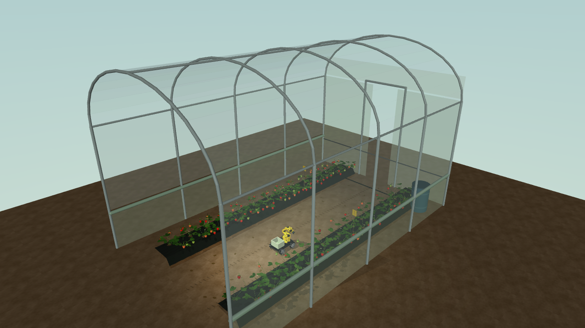
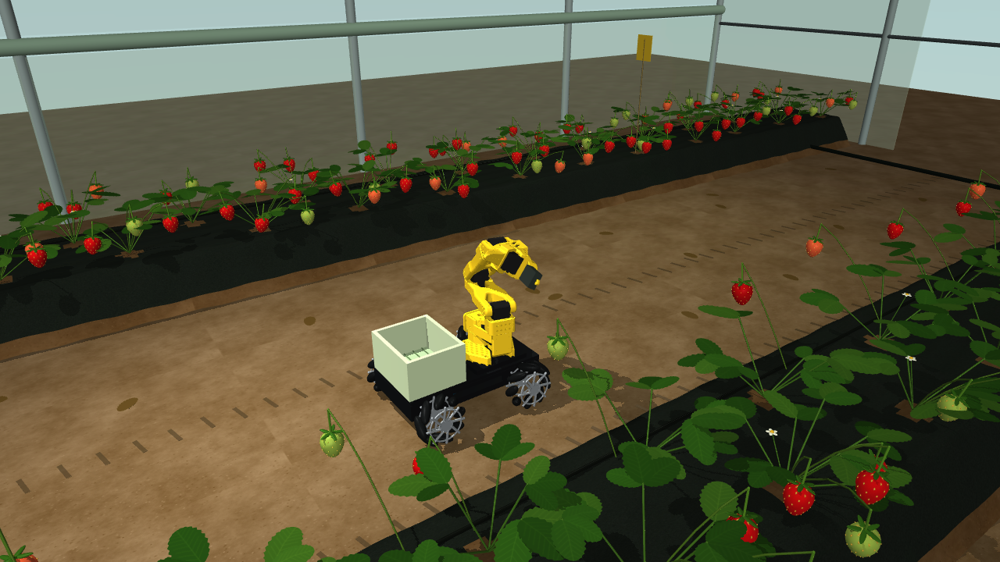
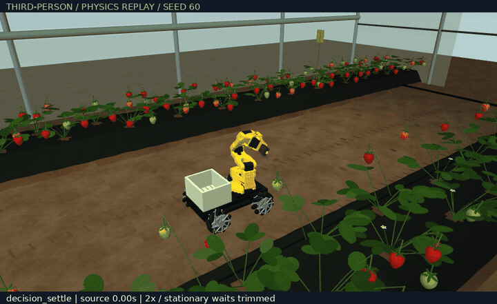
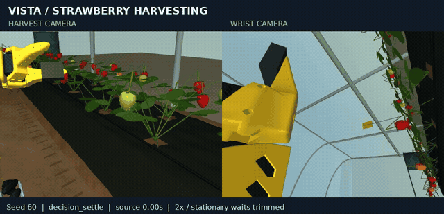
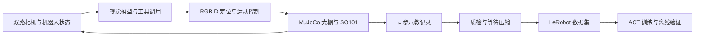

<div align="center">

# VISTA Strawberry Harvesting

**让机器人在大棚中观察、搜索、采摘与投筐**

Vision-guided harvesting · MuJoCo · SO101 · ACT

[场景](#大棚与小车) · [演示](#真实仿真演示) · [快速开始](docs/getting-started.md) · [系统架构](docs/architecture.md) · [实验结果](docs/results.md) · [技术案例](docs/engineering.md)

</div>

## 大棚与小车

| 大棚全景 | 小车、SO101 与车载筐 |
|---|---|
| [](docs/media/third-person/greenhouse-overview.png) | [](docs/media/third-person/robot-third-person.png) |

同一 seed 60 场景的两种展示视角，点击查看原图。第三视角仅用于展示，不加入模型观测或 ACT 训练输入。

## 真实仿真演示

[](docs/media/third-person/seed-060-third-person.mp4)

**Seed 60 · 第三视角物理回放 · 约 33 秒预览**

从原始控制指令重放物理过程，并用新增的外部相机拍摄；逐帧核对机器人状态、底盘位姿和 TCP，复核拉摘事件与独立入筐验收。展示视频压缩稳定等待并按 2 倍速播放，标注原始时间和阶段。

[第三视角 MP4](docs/media/third-person/seed-060-third-person.mp4) · [回放校验](docs/media/third-person/third-person-replay.json) · [双路相机完整原速 MP4（105.6 秒）](docs/media/seed-060-full.mp4)

<details>
<summary>查看原始双路相机视角：近景与腕部</summary>

[](docs/media/seed-060-preview.mp4)

[双路预览 MP4](docs/media/seed-060-preview.mp4) · [原图关键帧](docs/media/seed-060-poster.png) · [来源与剪辑说明](docs/media/README.md)

</details>

这是一次 **VISTA 风格视觉／工具控制器**的成功仿真示例，包含观察恢复、沿行搜索、果柄夹持、拉摘、投筐与返回；不是 ACT 策略演示，也不代表整体成功率。

## 项目做什么

在随机化草莓大棚中，使用移动底盘与 SO101 机械臂完成单颗成熟草莓采摘，并将过程记录为模仿学习数据。模型观察近景与腕部图像、选择候选并调用工具；RGB-D 几何计算与运动控制模块执行动作，仿真验收器独立判断结果。

| 视觉与决策 | 操作与恢复 | 数据与学习 |
|---|---|---|
| 双视角观察、成熟度复核、果柄候选定位 | 沿行搜索、调整观察位姿、居中夹持、拉摘与车载投筐 | 20 Hz 同步记录、等待压缩、LeRobot 导出、ACT 训练 |



[查看完整架构、模块职责与信息边界 →](docs/architecture.md)

## 当前进展

| 项目 | 已核验结果 |
|---|---|
| 示教数据 | 60 条验收轨迹，覆盖 59 个不同 seed |
| 训练／验证划分 | 50 / 10 条，两个集合的 seed 无交集 |
| 稳定等待压缩 | 100,211 → 76,526 帧，减少 **23.64%**；全部非等待帧保留 |
| 导出一致性 | **153,052 张 JPEG** 逐字节核验通过，状态与动作核对通过 |
| GPU 链路 | RTX 4060 Laptop 上完成 ACT 短程训练、检查点恢复与参数更新验证 |
| ACT 闭环采摘 | **尚未评估**；离线训练误差不等于采摘成功率 |

以上为 2026-11-13 的本地数据处理与链路验证快照。原始数据、数据集和权重未随 Git 仓库发布；已提供[汇总证据](docs/evidence/data-summary.json)、[评估口径与限制](docs/results.md)。数据来自两个场景版本，不作为固定版本基准成功率。

## 开始体验

无需安装即可查看上方录制回放。运行交互仿真需要 Linux、Python 3.12、OpenGL 环境，以及支持图像和工具调用的模型服务。

```bash
git clone https://github.com/Davidyu0604/vista-strawberry-harvesting.git
cd vista-strawberry-harvesting
python3.12 -m venv .venv
source .venv/bin/activate
python -m pip install -r requirements-vista.txt
cp .env.example .env
```

填写本地 `.env` 后，按[运行指南](docs/getting-started.md)进行配置检查、渲染检查与单回合采摘。训练环境单独配置，其独立安装流程仍待完善。

## 工程设计与问题分析

- **场景覆盖与搜索：** 区分地图中缺少目标和控制器搜索失败，明确双侧成熟果布局改变了任务分布。
- **视觉不确定性恢复：** 将候选复核、观察调整和搜索分开，避免一个不确定片段阻断所有候选。
- **数据质量：** 只压缩稳定等待，保留动作及接触阶段，用原始帧映射和哈希追踪来源。

[技术案例、项目实现范围与上游组件 →](docs/engineering.md)

## 代码导航

| 入口 | 作用 |
|---|---|
| [`vista.py`](vista.py) | 视觉模型交互与工具调度 |
| [`scene.py`](scene.py) · [`mobile_scene.py`](mobile_scene.py) | 大棚与移动搜索场景 |
| [`peduncle.py`](peduncle.py) · [`centered_grasp.py`](centered_grasp.py) | 果柄物理与夹持、拉摘控制 |
| [`training_preparation.py`](training_preparation.py) · [`export_act_dataset.py`](export_act_dataset.py) | 数据处理与 LeRobot 导出 |
| [`train_act.py`](train_act.py) | ACT 训练、离线验证和续训 |
| [`tests/`](tests/) · [`tools/`](tools/) | 自动测试、诊断与验证工具 |

开发细节见 [GUIDE](GUIDE.md) 和[文件说明](docs/FILES.md)。[本机历史笔记](docs/local-development-notes.md)保留旧实验过程，含未公开的本地数据引用。

## 后续工作

- [ ] 在独立测试 seed 上完成 ACT 闭环采摘评估，报告失败类型。
- [ ] 固定场景与控制器版本，建立可重复的采摘基准。
- [ ] 补齐独立训练环境安装与无需密钥的持续集成测试。
- [ ] 整理可分发的示例数据及模型发布说明。

## 许可证与来源

原创代码和文档采用 [Apache-2.0](LICENSE)，见 [NOTICE](NOTICE)。SO101 资产来自 TheRobotStudio/SO-ARM100，保留[上游许可证](assets/so101/LICENSE)和[来源版本及哈希](assets/so101/SOURCE.json)。项目为仿真实验实现，目前不提供真实机器人采摘效果结论。
