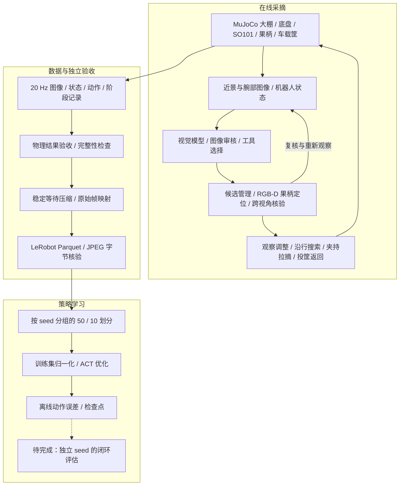

# 系统架构

[首页](../README.md) · [运行指南](getting-started.md) · [实验结果](results.md)

系统分为在线采摘、数据处理和策略学习三个部分。在线演示由视觉模型与工具控制器完成；ACT 从这些示教轨迹学习，目前没有已验证的 ACT 闭环采摘结果。

## 在线控制的职责划分

| 模块 | 负责什么 | 主要源码 |
|---|---|---|
| 视觉模型与工具循环 | 接收图像、判断候选、请求工具，管理执行反馈 | [`vista.py`](../src/vista.py)、提示词文件 |
| 候选与身份 | 保存局部候选，处理跨视角对应与重复片段 | [`local_targets.py`](../src/local_targets.py)、[`proposal_identity.py`](../src/proposal_identity.py) |
| 图像与深度定位 | 提出图像候选，拟合短果柄，结合视角证据定位 | [`visual_proposals.py`](../src/visual_proposals.py)、[`stalk_proposals.py`](../src/stalk_proposals.py) |
| 恢复与搜索 | 复核不确定候选、调整观察、沿行移动后重看 | [`perception_recovery.py`](../src/perception_recovery.py)、[`search_guidance.py`](../src/search_guidance.py) |
| 运动执行 | 居中夹持、分阶段拉摘、搬运及返回 | [`centered_grasp.py`](../src/centered_grasp.py)、[`vista.py`](../src/vista.py) |
| 仿真 | 场景布局、机械臂与底盘、果柄约束与车载筐 | [`scene.py`](../src/scene.py)、[`peduncle.py`](../src/peduncle.py)、[`mounted_basket.py`](../src/mounted_basket.py) |

模型调用工具后会获得实际执行或拒绝原因，下一轮基于新的观察继续决策。几何定位、运动执行和结果验收都有明确的代码边界；不能把整个系统描述为视觉模型直接端到端输出关节控制。

## 信息边界

模型的图像／工具观测与记录器保存的仿真诊断字段分别组织。果实真值位置、连接状态等字段可用于物理验收和离线数据核对，不作为 ACT 的额外输入。诊断信息用于数据处理，不代表部署时可获得该信息。

ACT 使用两路 RGB 图像与 9 维状态（6 维关节状态及底盘位姿），预测 8 维动作（6 维关节目标及底盘线速度、角速度）。训练时图像缩至 320 × 240，动作块长为 50，回合尾部使用 padding，避免动作块跨回合。

## 数据处理为什么单独进行

原始记录保留模型等待、恢复动作和失败过程。处理副本只移除满足稳定阈值的 `model_wait` 与 `decision_settle` 内部帧，保留片段边界以及所有非等待帧。导出时重新建立连续 20 Hz 时间轴，并保留源帧索引。

训练与验证以 seed 分组，归一化只使用训练侧。导出检查涵盖状态、动作、时间轴、JPEG 字节和回合边界。详细数字与证据范围见[实验结果](results.md)。

## 当前边界

目前评估对象是仿真环境。果柄、植被和底盘接触均为工程近似；大棚中的相机布置与真实硬件并非完全一致。训练数据同时包含 v22 和 v23 场景，ACT 闭环泛化、真实相机噪声和真实硬件迁移都还需要独立验证。
